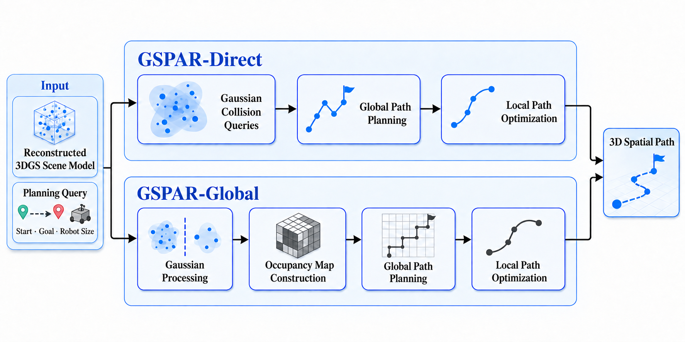
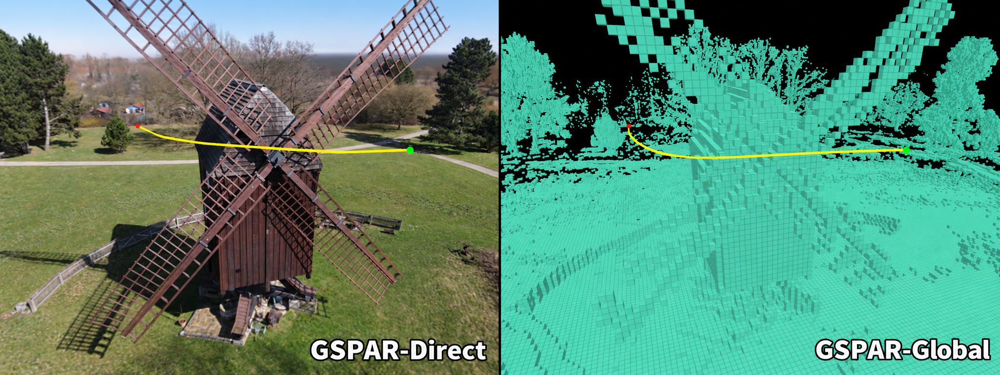
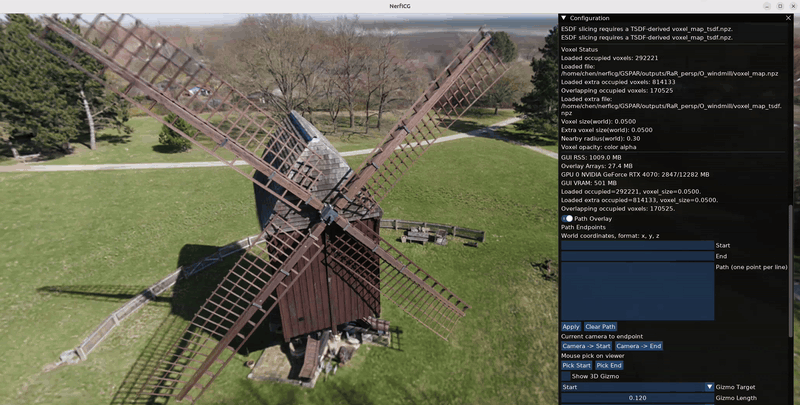

# GSPAR

**3D Gaussian Splatting Mapping and Path Planning for Active Scene Reconstruction**

GSPAR investigates how spatial information encoded in 3D Gaussian Splatting (3DGS) scene models can be used for 3D path planning. **GSPAR-Direct** performs collision queries directly on the Gaussian representation, while **GSPAR-Global** converts the Gaussian scene model into a reusable occupancy map for path planning.

This project was developed as part of a Master's thesis at TU Braunschweig.



| Method | Representation | Planning |
| --- | --- | --- |
| GSPAR-Direct | 3D Gaussian scene model | Gaussian collision queries, RRT, and trajectory optimization |
| GSPAR-Global | Occupancy map constructed from 3DGS | JPS global planning and EGO local optimization |



## Installation

Linux, an NVIDIA GPU, and a CUDA toolkit compatible with the PyTorch environment are recommended. GSPAR builds on [NeRFICG](https://github.com/nerficg-project/nerficg).

Clone this repository with its submodules:

```bash
git clone --recursive https://github.com/JiahaoChen14/GSPAR.git
cd GSPAR
```

Create the NeRFICG environment and install the main dependencies:

```bash
conda env create -f environments/py311_cu128.yaml
conda activate nerficg
conda install -c conda-forge scipy "cmake>=3.22" eigen glog
python scripts/install.py -m GaussianSplatting
```

## Scene Preparation

A 3DGS scene can be trained through NeRFICG. For example:

```bash
python scripts/create_config.py -m GaussianSplatting -d <DATASET_TYPE> -o <CONFIG_NAME>
python scripts/train.py -c configs/<CONFIG_NAME>.yaml
```

Planning and visualization typically use the resulting `training_config.yaml` and `checkpoints/final.pt`. The configuration restores the dataset and training coordinate system, while the checkpoint stores the reconstructed 3DGS scene model.

See the [NeRFICG documentation](https://github.com/nerficg-project/nerficg) for dataset preparation and additional reconstruction options.

Run the commands below from the **repository root**, replacing the placeholder paths with the corresponding scene paths.

## Interactive Planning

### GSPAR-Direct

Launch the viewer with a trained 3DGS scene:

```bash
python GSPAR/gui/launchViewerOverlay.py \
  --training-config-path output/<dataset>/<scene>/training_config.yaml \
  --checkpoint-path output/<dataset>/<scene>/checkpoints/final.pt
```

In `Path Overlay`, set the start position, goal position, and robot radius. Select `gspar-direct`, run the planner, and export the resulting path if needed.

GSPAR-Direct performs collision queries directly on the Gaussian representation and does not require prior occupancy map construction.

### GSPAR-Global

First, construct an occupancy map from the 3DGS checkpoint:

```bash
python GSPAR/mapping/gaussian_occupancy/build_sparse_voxel_map.py \
  --checkpoint output/<dataset>/<scene>/checkpoints/final.pt \
  --output-prefix GSPAR/outputs/<dataset>/<scene>/voxel_map \
  --voxel-size 0.05 \
  --block-size 8 \
  --scene-padding 0.02 \
  --scene-type outdoor
```

Choose `indoor` or `outdoor` for `--scene-type` according to the scene.

The generated `voxel_map.npz` stores the occupancy map used for planning, while `voxel_map.json` records the corresponding map parameters and spatial bounds.

Then launch the viewer with the generated map:

```bash
python GSPAR/gui/launchViewerOverlay.py \
  --training-config-path output/<dataset>/<scene>/training_config.yaml \
  --checkpoint-path output/<dataset>/<scene>/checkpoints/final.pt \
  --voxel-map GSPAR/outputs/<dataset>/<scene>/voxel_map
```

In `Path Overlay`, select `gspar-global`, set the start and goal positions, and run `Run Global (JPS-3D)` followed by `Run Local (EGO)`.

The global planning stage uses JPS on the occupancy representation. The same occupancy map can be reused for multiple planning queries.



### Coordinates and Scale

The start position, goal position, `voxel-size`, and planning radius must use the coordinate system of the 3DGS scene.

In the example above, `0.05` means **0.05 training scene units**. It corresponds to 5 cm only when the scene coordinates are metric.

Comparisons with an nvblox map constructed from depth require both representations to share a consistent coordinate system and compatible voxel resolutions.

## Multiple Scenes and Evaluation

For experiments involving multiple scenes, `configs/dataset.txt` can be used to configure scene paths, voxel resolutions, and optional depth and ground truth data.

The following script generates commands for map construction, reference map preparation, and visualization:

```bash
python GSPAR/scripts/generate_voxel_scene_command_txts.py
```

This step is optional when working with a single scene.

The batch modules run the mapping, planning, and ablation evaluation workflows after the required maps and reference data have been prepared:

```bash
python -m GSPAR.batch.mapping
python -m GSPAR.batch.paths
python -m GSPAR.batch.ablation
```

Ground truth geometry, depth data, nvblox maps, and SplatNav are used only in the experimental evaluation workflows. Neither GSPAR-Direct nor GSPAR-Global requires these components for ordinary path planning.

See [GSPAR/README.md](GSPAR/README.md) for the complete workflow and implementation details.

## Main Outputs

| File | Purpose |
| --- | --- |
| `GSPAR/outputs/<dataset>/<scene>/voxel_map.npz` | Occupancy map used by GSPAR-Global |
| `GSPAR/outputs/<dataset>/<scene>/voxel_map.json` | Map parameters and spatial bounds |
| `planned_path.txt` | Example path exported from the interactive viewer |
| `GSPAR/outputs/<dataset>/<scene>/path_evaluation/summary.json` | Summary of batch path planning evaluation |
| `GSPAR/outputs/<dataset>/<scene>/path_evaluation/records.jsonl` | Per-query path planning evaluation records |

When ground-truth geometry is configured for a scene, batch path-planning results are written to `GSPAR/outputs/<dataset>/<scene>/path_evaluation_gt/` instead.

## Repository Layout

The repository contains both the NeRFICG framework components required for 3DGS reconstruction and the GSPAR specific implementation.

| Directory | Purpose |
| --- | --- |
| `GSPAR/batch/` | Batch experiment workflows |
| `GSPAR/evaluation/` | Mapping and path planning evaluation |
| `GSPAR/gui/` | Interactive planning and visualization |
| `GSPAR/mapping/` | Occupancy and reference map construction |
| `GSPAR/path/` | Path planning components |
| `GSPAR/scripts/` | GSPAR utility scripts |
| `GSPAR/outputs/` | Generated maps and evaluation results |
| `configs/` | NeRFICG and dataset configuration files |
| `environments/` | Conda environment definitions |
| `resources/` | Figures and project resources |
| `scripts/` | NeRFICG training and utility scripts |
| `src/` | NeRFICG framework source code |

The main GSPAR implementation is located under `GSPAR/`. The `configs/`, `scripts/`, `src/`, and `environments/` directories primarily provide the NeRFICG infrastructure used for 3DGS reconstruction and scene loading.

## License and Acknowledgments

GSPAR is implemented on top of [NeRFICG](https://github.com/nerficg-project/nerficg) and uses additional external components for planning and evaluation.

The repository contains:

- the original [MIT License](LICENSE) associated with the NeRFICG based repository structure
- the license for the [GSPAR specific contributions](resources/gspar/LICENSE)
- the [external component notices](resources/gspar/THIRD_PARTY_NOTICES.md)

Before using or redistributing individual components, please also review the license information provided in the corresponding directories.

We acknowledge the following projects and libraries that support the implementation or evaluation of GSPAR:

- [NeRFICG](https://github.com/nerficg-project/nerficg)
- [nvblox](https://github.com/nvidia-isaac/nvblox)
- JPS3D
- SplatNav

SplatNav is used as an external comparison method in the path planning evaluation.
